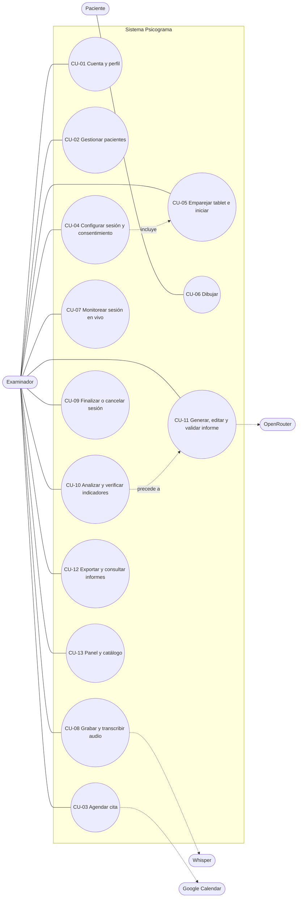
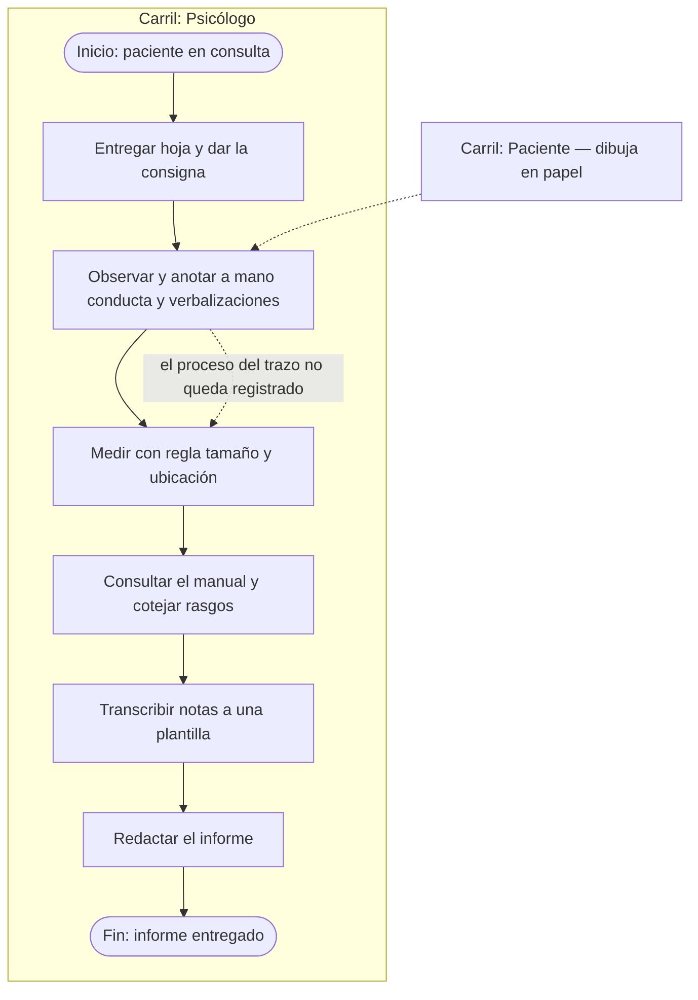
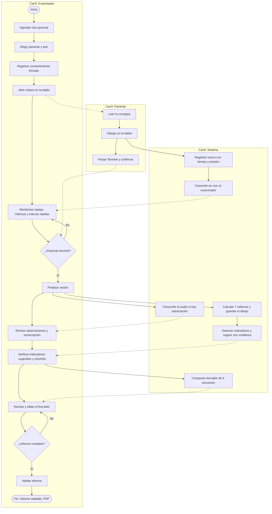
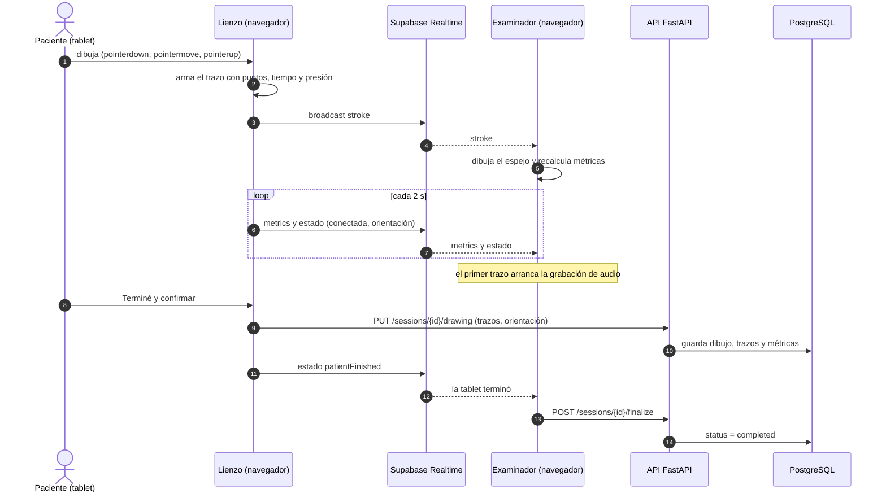
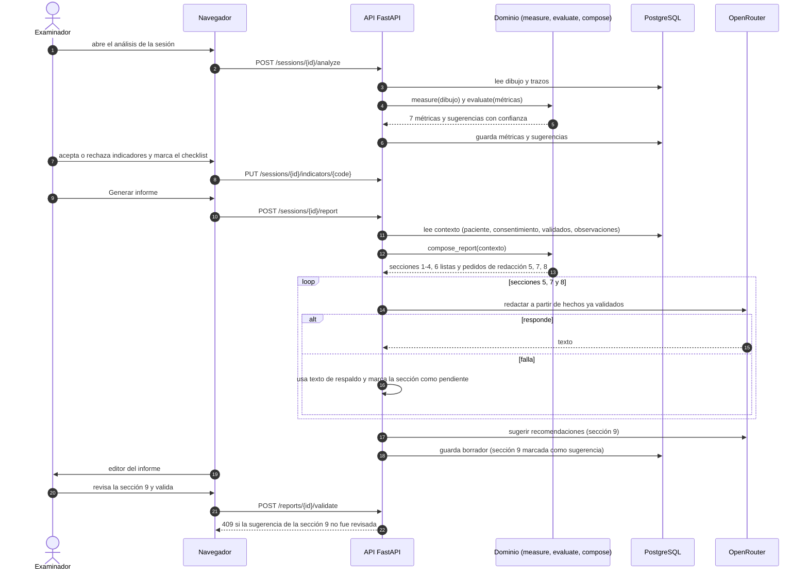
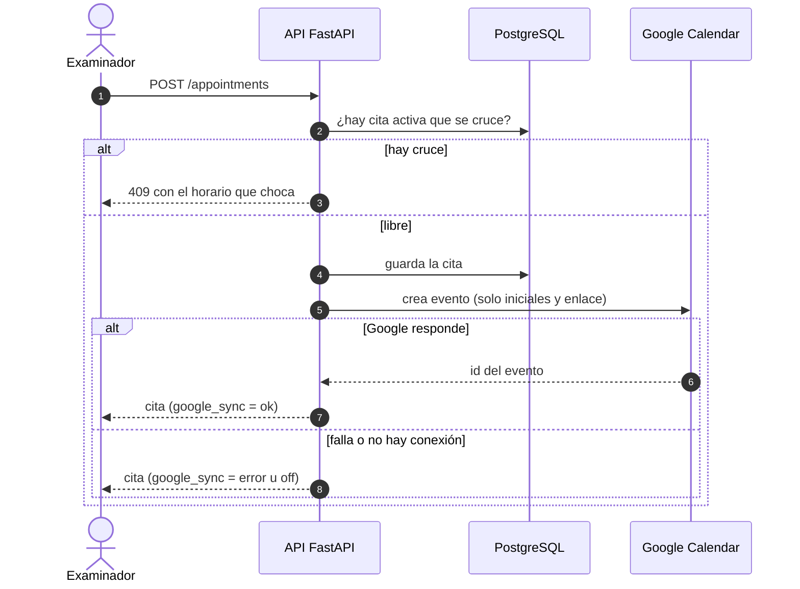
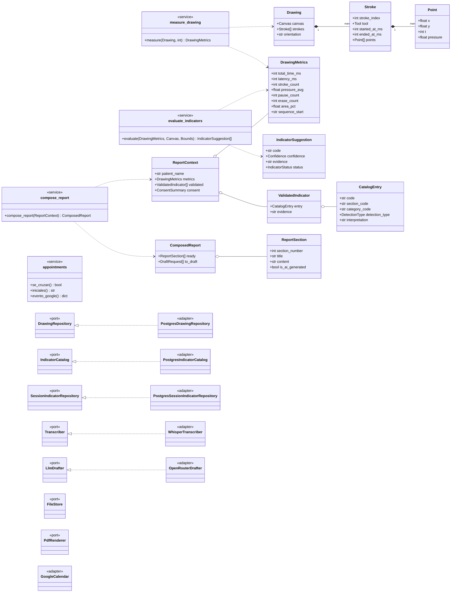
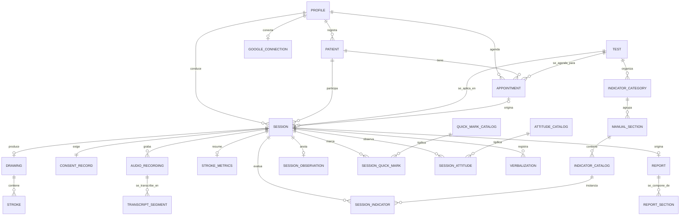

# CAPÍTULO 3: DESARROLLO DE LA SOLUCIÓN

## 3.1. Análisis de la situación

### Proceso actual (AS-IS) en el Centro Psicológico Ser Integral

| Paso | Actividad manual | Quién | Tiempo | Información que se pierde |
|---|---|---|---|---|
| 1 | Entregar la hoja y dar la consigna | Psicólogo | — | — |
| 2 | Observar el dibujo y anotar a mano conducta y verbalizaciones | Psicólogo | durante la sesión | Atención dividida entre paciente y cuaderno |
| 3 | Medir con regla el tamaño y la ubicación de la figura | Psicólogo | tras la sesión | Presión, orden, pausas, latencia, borrados (no se miden) |
| 4 | Consultar el manual y cotejar rasgo por rasgo | Psicólogo | tras la sesión | — |
| 5 | Abrir una plantilla y transcribir notas | Psicólogo | tras la sesión | Errores de transcripción |
| 6 | Redactar síntesis, observaciones y recomendaciones | Psicólogo | tras la sesión | — |
| 7 | Revisar y entregar el informe | Psicólogo | tras la sesión | — |

**Las tres deficiencias** (§1.2.1): doble esfuerzo de registro, pérdida de los indicadores temporales del proceso y variabilidad entre evaluadores.

**Magnitud del problema.** La variable dependiente es el tiempo desde el cierre de la sesión hasta la validación del informe (§2.1.1). Hoy **no existe una medición** de ese tiempo; se estima entre 45 y 90 minutos y se mide en el Capítulo 4. Esa medición es la línea base de todo el proyecto y no puede reconstruirse después de que el centro adopte el sistema.

### 3.1.1. Lean Canvas

El lienzo (Anexo 1, fecha 21/08/2026) describe el negocio como un *software de asistencia para psicólogos en la aplicación e interpretación de tests proyectivos de dibujo*. Su contenido, bloque por bloque:

| Bloque | Contenido |
|---|---|
| **Segmentos de clientes** | Psicólogos clínicos independientes · Centros y clínicas de psicología · *Early adopters*: psicólogos jóvenes con tablet y alta carga de informes · Nichos siguientes: RR. HH./psicolaboral y colegios |
| **Propuesta de valor** | El copiloto del psicólogo para tests de dibujo: reduce el tiempo del informe y estandariza criterios. Es el único que analiza el **proceso** del trazo (tamaño, presión, orden, tiempo) y no solo la imagen |
| **Canales** | Plataforma web (SaaS) · Colegio de Psicólogos, congresos y redes profesionales · Universidades · Demo gratuita y contacto directo |
| **Relación con clientes** | Autoservicio con *onboarding* y prueba gratuita · Soporte y capacitación en línea · Comunidad de psicólogos usuarios con retroalimentación continua |
| **Fuentes de ingreso** | Suscripción mensual/anual por psicólogo · Planes por clínica (multiusuario) · Paquetes de tests/informes premium · Modelo *freemium* · Pago con tarjeta y transferencia |
| **Recursos clave** | Núcleo técnico de captura de trazos · Equipo de desarrollo · Manuales de los tests y asesoría clínica · Infraestructura en la nube |
| **Actividades clave** | Desarrollo y mantenimiento de las dos interfaces (paciente y examinador) · Modelado de reglas de cada test y plantillas de informe · Afinamiento del reconocimiento de trazos · Seguridad y privacidad de datos de salud · Captación, soporte y capacitación |
| **Socios clave** | Colegio de Psicólogos del Perú · Universidades con facultad de Psicología · Psicólogos colaboradores que aporten casos reales · Proveedores de transcripción y modelos de lenguaje |
| **Estructura de costos** | Nube y APIs de transcripción y lenguaje · Desarrollo y mantenimiento (incluida seguridad y cumplimiento de datos de salud) · Marketing y captación |

> El lienzo es la visión comercial a futuro. El alcance de este curso es el piloto en un centro (§1.3.3); los ingresos y canales **no se validan** en este avance.

## 3.2. Alternativas de solución

Se evaluaron tres alternativas para reducir el tiempo de elaboración del informe.

| | **Alternativa 1** · Formulario digital | **Alternativa 2** · Escaneo/foto del dibujo + análisis automático | **Alternativa 3** · Captura digital del proceso del trazo *(elegida)* |
|---|---|---|---|
| Idea | El profesional completa en pantalla cada criterio y el sistema compone el informe (es lo que hacen las soluciones comerciales, §1.3.5) | Se fotografía el dibujo en papel y un modelo de visión por computador o multimodal lo analiza | El paciente dibuja en una tablet; el sistema registra cada trazo con su tiempo, presión y orden, mide el dibujo y propone indicadores |
| Qué mide | Nada: el profesional ingresa todo | Solo la imagen final (tamaño, ubicación, forma) | Imagen **y proceso**: latencia, pausas, secuencia, borrados, presión |
| Riesgo principal | No reduce la parte mecánica de medir; solo la de redactar | Pierde los indicadores temporales; envía fotos de pacientes a servicios externos; precisión limitada en dibujos esquemáticos | Cambia el medio (tablet en lugar de papel); exige tablet con lápiz |

### Matriz de decisión

Puntaje de 1 (malo) a 5 (muy bueno), ponderado. Los puntajes son **juicio del equipo** fundado en lo descrito arriba; no son mediciones.

| Criterio | Peso | Alt. 1 | Alt. 2 | Alt. 3 |
|---|---|---|---|---|
| Cobertura de los indicadores del manual (incluidos los temporales) | 25 % | 2 | 3 | 5 |
| Reducción del tiempo del informe | 20 % | 2 | 4 | 5 |
| Fidelidad al test proyectivo (no contaminar el estímulo) | 15 % | 5 | 4 | 4 |
| Privacidad y riesgo ético | 15 % | 4 | 2 | 4 |
| Costo y complejidad | 10 % | 5 | 2 | 3 |
| Viabilidad en el plazo del curso | 15 % | 5 | 3 | 4 |
| **Total ponderado** | 100 % | **3,50** | **3,10** | **4,35** |

**Decisión: Alternativa 3.** Es la única que aborda el vacío central del estado del arte (el proceso del trazo) y la que más reduce el trabajo mecánico. La alternativa 1 es la más simple, pero deja la medición en manos del profesional; la 2 pierde justamente los indicadores que el papel no conserva. **Riesgo asumido:** la validez del test aplicado en tablet respecto del papel no está estudiada; por eso la interfaz del paciente evita cualquier elemento que altere el estímulo (§2.1.3) y se declara como limitación (§1.3.3).

## 3.3. Planificación

### 3.3.1. Project Charter

(Anexo 3. Se corrigieron los siete defectos del Avance 2: ver Anexo 3-4.)

| Campo | Valor |
|---|---|
| Proyecto | Psicograma |
| Jefe de proyecto | Joaquin Sebastian Chaparro Villavicencio |
| Patrocinador | Centro Psicológico Ser Integral E.I.R.L. |
| Fecha de inicio / fin | 10/08/2026 — 11/12/2026 |
| Equipo | Yefrei Bernable · Jose Diaz · Iam Arias · Jonathan Tuppia · Joaquin Chaparro |
| Metodología | Desarrollo guiado por especificaciones (SDD) con *sprints* tipo Scrum y pruebas primero |

**Entregables:** (1) especificación de requerimientos IEEE 830; (2) módulo de gestión de pacientes, citas y sesiones; (3) módulo del paciente (captura del dibujo) y módulo del examinador; (4) módulo de procesamiento de medidas objetivas; (5) módulo de generación del borrador de informe; (6) auditoría del sistema y medición de la reducción de tiempo.

**Riesgos principales:** línea base de tiempos inexistente (R-05); desviación entre el alcance documentado y el implementado (R-01, **cerrado** al alinear el código con el Capítulo 1: categorías C y D desactivadas); rol de base de datos con `BYPASSRLS` (R-08); canal en tiempo real no privado (R-07). Detalle en §3.10.3.

### 3.3.2. Cronograma (Gantt)

(Anexo 4.) Estado al **28/10/2026**; la ventana del proyecto es 10/08 – 11/12/2026.

| Fase | Actividad | Responsable | Inicio | Fin | Estado |
|---|---|---|---|---|---|
| 1 | Planificación (misión, visión, alcance) | Joaquin Chaparro | 10/08 | 11/08 | ✅ Completado |
| 1 | Reunión inicial con el cliente | Jose Diaz | 15/08 | 17/08 | ✅ Completado |
| 1 | Requerimientos (SRS IEEE 830) | Yefrei Bernable | 08/09 | 10/09 | ✅ Completado |
| 1 | Arquitectura y base de datos (hexagonal, 2FN) | Jonathan Tuppia | 18/09 | 25/09 | ✅ Completado |
| 1 | Diagramas de diseño | Iam Arias | 28/09 | 05/10 | ✅ Documentados en este avance (§3.5–3.9) |
| 2 | Sprint 1 — Fundación | Joaquin Chaparro | 18/08 | 22/08 | ✅ (despliegue diferido) |
| 2 | Sprint 2 — Pacientes, panel y sesiones | Yefrei Bernable | 25/08 | 01/09 | ✅ |
| 2 | Sprint 3 — Lienzo y sesión en vivo | Jonathan Tuppia | 04/09 | 11/09 | ✅ |
| 2 | Sprint 4 — Análisis y motor de reglas | Iam Arias | 16/09 | 22/09 | ✅ |
| 2 | Sprint 5 — Rearquitectura (backend hexagonal y BD) | Joaquin Chaparro | 25/09 | 06/10 | 🟡 En proceso (71 %): implementado · ⚠️ cierre de RLS (R-08) y validación contra entorno real pendientes |
| 2 | Sprint 6 — Informe, PDF y cierre funcional | Jose Diaz | 13/10 | 26/10 | ✅ Implementado · ⚠️ recorrido completo en navegador pendiente (§4.1.1) |
| 2 | Extensión — Agenda de citas y Google Calendar | Joaquin Chaparro | 28/10 | 28/10 | 🟡 Código y pruebas listos · ⚠️ falta aplicar la migración y probar el OAuth real |
| 3 | Auditoría del sistema (QA, seguridad, medición) | Iam Arias | 02/11 | 11/11 | ⏳ En curso: auditoría técnica hecha el 28/10; medición pendiente |
| 3 | Despliegue y capacitación | Jose Diaz | 20/11 | 24/11 | ⏳ Sin empezar |
| 3 | Cierre del proyecto | Joaquin Chaparro | 07/12 | 08/12 | ⏳ Sin empezar |

> **Nota de honestidad sobre el avance.** Los porcentajes del Avance 2 estaban a corte 30/09. Este cuadro marca «✅» solo lo que tiene código y pruebas en el repositorio y deja explícito con ⚠️ lo que depende de algo no verificado.

## 3.4. Prototipos

Los 13 prototipos del Avance 1 (Anexo 5) se implementaron como pantallas reales. La tabla relaciona cada prototipo con su pantalla y su ruta.

| # | Prototipo | Pantalla implementada | Ruta | Interfaz |
|---|---|---|---|---|
| 1 | Dashboard principal | `DashboardPage` | `/` | Examinador |
| 2 | Listado de pacientes | `PatientsPage` | `/pacientes` | Examinador |
| 3 | Ficha del paciente | `PatientDetailPage` | `/pacientes/:id` | Examinador |
| 4 | Catálogo de tests proyectivos | `TestCatalogPage` | `/tests` | Examinador |
| 5 | Nueva sesión y consentimiento | `NewSessionPage` | `/sesiones/nueva` | Examinador |
| 6 | Sesión en vivo | `ExaminerSessionPage` | `/sesion/:id` | Examinador |
| 7 | Observaciones post-sesión | `PostSessionPage` | `/sesion/:id/observaciones` | Examinador |
| 8 | Verificación profesional | `AnalysisPage` (pestaña) | `/sesion/:id/analisis` | Examinador |
| 9 | Análisis de resultados | `AnalysisPage` | `/sesion/:id/analisis` | Examinador |
| 10 | Editor de informe | `ReportsPage` | `/informes/:id` | Examinador |
| 11 | Bienvenida del paciente | `PatientWelcomePage` | `/sesion/:id/paciente/bienvenida` | Paciente |
| 12 | Lienzo de dibujo | `PatientDrawingPage` | `/sesion/:id/paciente/dibujo` | Paciente |
| 13 | Cierre del paciente | `PatientClosePage` | `/sesion/:id/paciente/cierre` | Paciente |

**Pantallas añadidas después del prototipo** (reales, sin prototipo previo): Citas (`/citas`), Sesiones (`/sesiones`), Informes (`/informes`), Ajustes y conexión con Google Calendar (`/ajustes`), entrada de la tablet (`/sesion/activa`) e inicio de sesión (`/login`). Con ellas el sistema tiene **18 pantallas de página** (`src/pages`).

**Revisión de interfaz del 28/10/2026.** Se recorrieron las pantallas en un navegador real y se corrigieron, entre otros: variables de CSS sin definir que dejaban botones y fondos invisibles (por ejemplo «Generar informe»), el dibujo del paciente que quedaba fuera de pantalla en el análisis, columnas con datos incorrectos en Pacientes, y el bloqueo de una sesión sin consentimiento firmado (DT-037). Las capturas comparativas prototipo/pantalla real van en el Anexo 5.

**Principio de diseño de la interfaz del paciente.** Hoja en blanco, lápiz, borrador y deshacer; sin colores, grosores, guías, cuadrícula ni mensajes de aliento, porque cualquiera de ellos es un estímulo que contamina el test. La hoja se entrega horizontal («a lo largo», como indica el manual) y se respeta si el paciente la gira; el giro se registra como dato (RF-17).

## 3.5. Diagrama de casos de uso

**Actores.** *Examinador* (psicólogo; usuario principal), *Paciente* (solo ve el lienzo de su sesión) y los actores externos *Whisper* (transcripción), *OpenRouter* (redacción asistida) y *Google Calendar* (agenda). Los 41 requerimientos funcionales se agrupan en 13 casos de uso.

| Caso de uso | Actor | Descripción | Requerimientos |
|---|---|---|---|
| CU-01 Cuenta y perfil | Examinador | Registro, inicio de sesión, perfil con matrícula y especialidad; acceso del paciente restringido a su lienzo | RF-01, RF-02, RF-03 |
| CU-02 Gestionar pacientes | Examinador | Registrar, actualizar, listar con búsqueda y filtros, ver ficha, dar de baja lógica | RF-04 a RF-08 |
| CU-03 Agendar cita | Examinador, Google Calendar | Fijar fecha y hora sin cruces; reflejar la cita como evento (solo iniciales del paciente); convertirla en sesión | Ampliación de RF-09 (SPEC-CAL-01) |
| CU-04 Configurar sesión y consentimiento | Examinador | Asistente de tres pasos (paciente, test, consentimiento firmado) | RF-09, RF-10 |
| CU-05 Emparejar tablet e iniciar | Examinador | Vincular la tablet a la sesión y conocer su estado de conexión | RF-11, RF-25 |
| CU-06 Dibujar | Paciente | Consigna, lienzo con lápiz, borrador y deshacer, captura temporal, cierre | RF-14 a RF-19 |
| CU-07 Monitorear sesión en vivo | Examinador | Espejo del dibujo, métricas cada 2 s, marcas rápidas, observaciones y actitudes | RF-20 a RF-24 |
| CU-08 Grabar y transcribir audio | Examinador, Whisper | Grabar (con autorización), transcribir con marcas de tiempo y extraer verbalizaciones | RF-26 a RF-28 |
| CU-09 Finalizar o cancelar sesión | Examinador | Cierre desde cualquier dispositivo o cancelación conservando el registro | RF-12, RF-13 |
| CU-10 Analizar y verificar indicadores | Examinador | Medición objetiva, detección automática, sugerencias con confianza y checklist; aceptar o rechazar | RF-29 a RF-34 |
| CU-11 Generar, editar y validar informe | Examinador, OpenRouter | Borrador de 9 secciones, edición por sección y validación con responsable y fecha | RF-35 a RF-37 |
| CU-12 Exportar y consultar informes | Examinador | PDF del informe validado e historial por paciente | RF-38, RF-39 |
| CU-13 Panel y catálogo | Examinador | Indicadores de gestión y catálogo de tests | RF-40, RF-41 |

## 3.6. Diagrama de procesos (BPM)

**Leyenda de notación (BPMN simplificada en Mermaid).**

| Símbolo | Significado |
|---|---|
| Óvalo `([ ])` | Evento de inicio o fin |
| Rectángulo `[ ]` | Tarea |
| Rombo `{ }` | Compuerta (decisión) |
| Rectángulo redondeado grande | Carril (responsable) |
| Flecha continua | Flujo de secuencia |
| Flecha punteada | Intercambio de información entre carriles |

### Proceso actual (AS-IS)

### Proceso propuesto (TO-BE) con Psicograma

## 3.7. Diagramas de secuencia

### Sesión en vivo: del trazo al espejo y las métricas

### Generación del informe

### Agenda y Google Calendar

## 3.8. Diagrama de clases

Derivado del código real (`backend/src/psicograma/`). Las **entidades y servicios** viven en el dominio, que no importa infraestructura; los **puertos** son interfaces (`Protocol`); los **adaptadores** los implementan.

**Capa de entrada (controladores).** Los routers de FastAPI (`sessions`, `patients`, `analysis`, `audio`, `reports`, `appointments`, `google`, `profile`, `dashboard`, `catalogs`) reciben la petición, validan con los esquemas Pydantic (`schemas.py`) y llaman a los *stores* o a los servicios del dominio. Los *stores* (`PatientStore`, `SessionStore`, `AppointmentStore`, `ReportStore`…) hacen el acceso a datos que **no tiene reglas de negocio** (CRUD) y por eso no pasan por el núcleo; lo que sí tiene reglas (medir, evaluar, componer el informe, solapar horarios) vive en `domain/services/`.

## 3.9. Modelo de datos

### 3.9.1. Modelo conceptual

Solo entidades y relaciones, sin atributos.

### 3.9.2. Modelo lógico

**24 tablas** (22 del esquema base más 2 de la agenda) en el esquema `public`, normalizadas a **2FN**, con clave primaria (PK), claves foráneas (FK) y restricciones. Atributos principales:

| Grupo | Tabla | PK | Atributos y claves foráneas principales |
|---|---|---|---|
| Catálogo | `tests` | id | code (único), name, is_available |
| Catálogo | `indicator_categories` | id | test_id → tests, code, name; **UNIQUE (test_id, code)** |
| Catálogo | `manual_sections` | id | category_id → indicator_categories, code, name, code_prefix; UNIQUE (category_id, code) |
| Catálogo | `indicator_catalog` | code | section_id → manual_sections, title, interpretation, detection_type (`auto`/`semi`/`manual`), is_active |
| Catálogo | `quick_mark_catalog`, `attitude_catalog` | code | label, display_order |
| Identidad | `profiles` | id (= usuario de autenticación) | full_name, license_number, specialty |
| Pacientes | `patients` | id | full_name, document_number, birth_date, sex, is_active, anonymized_at, created_by → profiles; **UNIQUE (created_by, document_number)** |
| Sesión | `sessions` | id | patient_id → patients, test_id → tests, status (`setup`/`consent`/`active`/`completed`/`cancelled`), reason, started_at, completed_at, created_by → profiles |
| Sesión | `consent_records` | id | session_id → sessions (único), audio_authorized, digital_authorized, confidential_ack, signature_url, signed_at |
| Dibujo | `drawings` | id | session_id → sessions (único), final_image_url, orientation (`horizontal`/`vertical`), canvas_width, canvas_height |
| Dibujo | `strokes` | id | drawing_id → drawings, stroke_index, tool, started_at_ms, ended_at_ms, point_count, avg_pressure, bbox_*, points (JSONB); UNIQUE (drawing_id, stroke_index); CHECK ended ≥ started |
| Dibujo | `stroke_metrics` | id | session_id → sessions (único), total_time_ms, latency_ms, stroke_count, pressure_avg, pause_count, erase_count, area_pct, sequence_start |
| Audio | `audio_recordings` | id | session_id → sessions, storage_path, duration_seconds, started_at_ms, transcribed_at |
| Audio | `transcript_segments` | id | recording_id → audio_recordings, segment_index, start_ms, end_ms, text, segment_type (`speech`/`annotation`) |
| Registro | `session_observations` | session_id → sessions | additional_notes |
| Registro | `session_quick_marks` | id | session_id → sessions, mark_code → quick_mark_catalog, marked_at_ms |
| Registro | `session_attitudes` | **(session_id, attitude_code)** | → sessions, → attitude_catalog |
| Registro | `verbalizations` | id | session_id → sessions, offset_ms, text, source (`transcription`/`examiner`) |
| Análisis | `session_indicators` | **(session_id, indicator_code)** | → sessions, → indicator_catalog; status (`suggestion`/`validated`/`rejected`), source (`auto`/`llm`/`manual`), confidence, evidence, validated_by → profiles, validated_at; CHECK: un indicador validado exige responsable y fecha |
| Informe | `reports` | id | session_id → sessions (único), status (`draft`/`validated`), validated_by, validated_at, pdf_url; CHECK: un informe validado exige responsable y fecha |
| Informe | `report_sections` | id | report_id → reports, section_number, title, content, is_ai_generated, edited_by_examiner; UNIQUE (report_id, section_number) |
| Agenda | `appointments` | id | patient_id → patients, test_id → tests, created_by → profiles, starts_at, ends_at, status (`scheduled`/`started`/`cancelled`), notes, session_id → sessions, google_event_id; CHECK ends_at > starts_at; EXCLUDE (sin solapes) |
| Agenda | `google_connections` | user_id → profiles | refresh_token (cifrado), connected_at |

**Por qué 2FN.** El catálogo del manual ya no se repite en cada evaluación: `session_indicators` tiene una PK compuesta y todos sus atributos dependen de la clave completa; los datos del indicador viven una sola vez en `indicator_catalog`. Las listas que se filtran u ordenan van en su propia tabla (por ejemplo `session_quick_marks`); el JSONB se reserva a datos atómicos que nunca se consultan por dentro (`strokes.points`).

### 3.9.3. Modelo físico

Implementado en PostgreSQL 17 (Supabase). El script completo es `sdd/database/schema.sql` y la imagen es el Anexo 6 (modelo físico). Decisiones físicas relevantes:

- **Tipos:** `UUID` (generado en la base con `uuid_generate_v4()`), `TIMESTAMPTZ` en todos los instantes, `JSONB` solo en `strokes.points`, `TEXT` con restricciones `CHECK` para los estados.
- **Integridad:** claves foráneas en todas las relaciones y un **índice en cada clave foránea**; `UNIQUE` sobre `(created_by, document_number)` para impedir pacientes duplicados por examinador.
- **Agenda sin cruces:** `appointments` incluye una **restricción de exclusión** (`EXCLUDE USING gist (created_by WITH =, tstzrange(starts_at, ends_at) WITH &&) WHERE (status <> 'cancelled')`), que garantiza en la base que un examinador no tenga dos citas activas solapadas, incluso con dos peticiones simultáneas.
- **Seguridad:** *Row Level Security* activa en **todas** las tablas, con políticas «solo lo tuyo» (`auth.uid() = created_by`) y una función auxiliar `owns_session(sid)` para las tablas hijas. La política de `appointments` valida además, con `WITH CHECK`, que el paciente y la sesión referenciados también pertenezcan al examinador.
- **Archivos:** el audio y las imágenes se guardan en un *bucket* privado (`session-files`); el audio se entrega al navegador a través del backend (`GET /recordings/{id}/audio`), que comprueba la propiedad por RLS, y no mediante enlaces públicos.
- **Evolución:** migraciones de Alembic (`backend/migrations/versions/`): `0001` esquema inicial 2FN, `0002` privacidad de pacientes, `0003` agenda y Google.

## 3.10. Implementación

### Stack tecnológico

El docente autorizó un **stack libre**; no se usa Java. La rúbrica pide MVC, TDD, DAO, SOLID y librerías de apoyo: la sección 3.10.1 muestra la equivalencia con el stack elegido y la evidencia verificable en el repositorio.

| Capa | Tecnología | Versión |
|---|---|---|
| Backend | Python · FastAPI · Uvicorn | 3.12 · 0.141 · 0.54 |
| Acceso a datos | SQLAlchemy asíncrono · asyncpg · Alembic | 2.1 · 0.31 · 1.20 |
| Validación y esquemas | Pydantic | 2.13 |
| Seguridad | PyJWT (verificación ES256/HS256) · `cryptography` (Fernet) | 2.15 · 50.0 |
| Integraciones | `httpx` (OpenAI Whisper, OpenRouter, Google Calendar) · WeasyPrint (PDF) | 0.28 · — |
| Frontend | React · TypeScript · Vite · React Router | 19.2 · 6.0 · 8.2 · 7.18 |
| Plataforma | Supabase: PostgreSQL 17, Auth, Storage privado, Realtime | — |
| Pruebas y calidad | pytest · Node test runner · Ruff · `check-hexagon.sh` | 9.1 · — · 0.16 · — |

### 3.10.1. Equivalencias de arquitectura y recursos

#### Principios que exige la rúbrica

| Exige la rúbrica | Cómo se aplica en Psicograma | Evidencia en el repositorio |
|---|---|---|
| **MVC** | **Modelo:** entidades del dominio (`domain/model.py`) y modelos de persistencia (`adapter/outbound/postgres/models.py`). **Vista:** el frontend React (`frontend/src/pages`, `components`). **Controlador:** los routers de FastAPI y los esquemas Pydantic (`adapter/inbound/http/`). | Carpetas citadas; contrato de la API en `sdd/api-contracts.md` |
| **DAO** | Cada acceso a datos con reglas pasa por un **puerto** (interfaz `Protocol` en `domain/ports.py`: `DrawingRepository`, `IndicatorCatalog`, `SessionIndicatorRepository`) con su implementación PostgreSQL en `adapter/outbound/postgres/repositories.py`. El CRUD sin reglas usa *stores* (`PatientStore`, `SessionStore`, `AppointmentStore`…) | `domain/ports.py`, `repositories.py`, `store.py` |
| **TDD** | Regla del proyecto (R1–R2 de `sdd/AGENTS.md`): primero la especificación en Given-When-Then (`sdd/spec/`), luego la prueba y después el código. Hay 153 pruebas de backend recogidas por pytest (al menos 61 corren sin red ni base de datos; el resto se ejecuta contra la base real) y 11 del frontend | `backend/tests/`, `frontend/tests/`, `sdd/spec/` |
| **SOLID** | Ver tabla siguiente | `scripts/check-hexagon.sh`, `config/container.py` |

| Principio | Aplicación concreta |
|---|---|
| **S** — responsabilidad única | Un servicio de dominio por tarea: `measure_drawing` (medir), `evaluate_indicators` (proponer), `compose_report` (armar el informe), `appointments` (reglas de agenda). Los routers solo traducen HTTP |
| **O** — abierto/cerrado | El catálogo del manual es **dato** (`indicator_catalog`): agregar un test o un indicador no exige tocar la lógica. Los umbrales de detección son parámetros (`Thresholds`) |
| **L** — sustitución de Liskov | Cualquier objeto que cumpla el `Protocol` es intercambiable: un transcriptor falso reemplaza a Whisper en las pruebas sin cambiar el servicio |
| **I** — segregación de interfaces | Puertos pequeños y específicos (siete `Protocol`), no una interfaz única de «infraestructura» |
| **D** — inversión de dependencias | El dominio **no importa** FastAPI, SQLAlchemy, httpx ni Pydantic; depende de puertos que los adaptadores implementan. Lo comprueba `check-hexagon.sh` (resultado del 28/10: *OK*). El único lugar donde dominio e infraestructura se encuentran es `config/container.py` |

#### Librerías de apoyo que exige la rúbrica (equivalentes en el stack elegido)

| Librería Java de la rúbrica | Función | Equivalente usado | Dónde |
|---|---|---|---|
| **Google Guava** | Colecciones, caché y utilidades | Biblioteca estándar de Python: `functools.lru_cache`, `itertools`, `dataclasses` | `get_settings` con caché; `Point`, `Stroke`, `Drawing` como `dataclass(frozen=True, slots=True)` |
| **Apache POI** | Generación de documentos | **WeasyPrint** para exportar el informe validado a PDF (RF-38) | `routers/reports.py`, `tests/adapter/test_pdf.py` |
| **Apache Commons** | Validación y utilidades | **Pydantic** (validación en la frontera), `cryptography` (cifrado) y `httpx` (cliente HTTP) | `schemas.py`, `google_calendar.py` |
| **Logback** | Registro de eventos | Módulo `logging` de Python | `app.py`, `routers/google.py`. ⚠️ Es registro básico (11 puntos); falta configurar formato y niveles por entorno |

> **Alcance de la equivalencia.** Las librerías Java no se usan porque el lenguaje es otro; lo que se demuestra es el **uso de recursos equivalentes con consideraciones de seguridad** (validación en la frontera, cifrado del token de Google, registro sin datos personales), que es lo que la rúbrica evalúa en el criterio «Uso de recursos».

### 3.10.2. Avance por sprint

| Etapa | Contenido | Estado al 28/10/2026 |
|---|---|---|
| Fase 1 | Planificación, relevamiento, SRS (41 RF, 30 RNF), arquitectura y diagramas | 5/5 |
| Sprint 1 | Fundación, autenticación, layout, despliegue | 4/5 (despliegue diferido) |
| Sprint 2 | Pacientes, panel y sesiones | 6/6 |
| Sprint 3 | Lienzo del paciente, espejo en vivo, métricas, marcas, audio | 8/8 |
| Sprint 4 | Catálogo (183 indicadores), medición objetiva, sugerencias, checklist | 5/5 |
| Sprint 5 | Rearquitectura: backend hexagonal y BD 2FN | 3/7 completas · 4 parciales (repositorios y validación contra entorno real, endpoints, retiro del acceso directo, migraciones) |
| Sprint 6 | Informe, PDF y cierre funcional | 6/6 **implementadas** (sin recorrido completo en navegador) |
| Extensión | Agenda y Google Calendar | Código y pruebas listos; migración y OAuth real pendientes |
| Fase 3 | Auditoría (AUD-01 a AUD-05) | AUD-01, AUD-02, AUD-04 y AUD-05 con trabajo parcial; ninguna cerrada |

**Total del plan de 47 tareas:** 31 completas + 6 implementadas del Sprint 6 = **37 de 47 (79 %)**; con las 4 parciales del Sprint 5 y la extensión, el trabajo en curso supera ese número. Se informa el 79 % como «completo o implementado» y **no** como «verificado»: la verificación de punta a punta sigue pendiente.

**Cumplimiento del 30 % de funcionalidades que pide la rúbrica.** El Anexo 14 relaciona los 41 requerimientos funcionales con su implementación: **28 implementados y verificados** (por prueba automática o por revisión en navegador), **9 implementados sin verificación completa** y **4 cubiertos parcialmente** (con la razón de cada uno). Ningún requerimiento está sin componente. Es decir, **37 de 41 (90 %) están implementados**, muy por encima del 30 % exigido.

### 3.10.3. Seguridad

| Amenaza | Medida implementada | Evidencia |
|---|---|---|
| Acceso no autenticado | El backend verifica el JWT de Supabase (ES256 por JWKS o HS256), con `aud=authenticated`; sin token válido responde 401 | `adapter/inbound/http/auth.py`; pruebas de 401 |
| Un examinador lee datos de otro | **Doble capa:** filtro en los repositorios y *Row Level Security* en las 24 tablas; cada petición abre una transacción con `SET LOCAL ROLE authenticated` y la identidad propagada. Los recursos ajenos responden 404 (no 403) para no confirmar su existencia | `engine.py::session_for`; pruebas de aislamiento entre dos cuentas reales |
| El navegador accede a la base | El frontend **no tiene credenciales** de base de datos; todo pasa por la API (RNF-12) | `sdd/api-contracts.md` |
| Fuga de datos personales en los registros | El registro de errores de integridad guarda solo el nombre de la restricción y el SQLSTATE, **nunca** el `DETAIL` (que traía el documento del paciente) | `app.py::_restriccion`; prueba `test_log_integridad` |
| Error interno que filtra detalles | Un 500 devuelve un mensaje genérico; el detalle queda en el servidor | `app.py` (manejador de excepciones) |
| Grabación sin permiso | El audio solo se graba con autorización en el consentimiento; una sesión sin consentimiento firmado no permite iniciar la toma | RF-10, RF-26; pantalla de sesión |
| Robo del acceso a Google Calendar | El *refresh token* se guarda **cifrado** (Fernet) y solo el backend lo descifra; el `state` de OAuth es un JWT firmado de 10 minutos con un uso propio, y **no sirve como token de sesión** (prueba dedicada) | `google_calendar.py`; `test_google_calendar.py` |
| Datos del paciente en un servicio externo | El evento de Google lleva **solo iniciales** y un enlace; la regla es pura y está probada | `domain/services/appointments.py` |
| Referencias cruzadas en la agenda | `WITH CHECK` en la política de `appointments`: el paciente y la sesión referenciados deben ser del examinador | `migrations/versions/0003_citas_y_google.py` |
| Archivos accesibles públicamente | *Bucket* privado; el audio se sirve por el backend con comprobación de propiedad | `routers/audio.py` |
| Secretos en el repositorio | `.env` no está versionado; búsqueda de claves en archivos rastreados: sin coincidencias reales; `npm audit` de producción: 0 vulnerabilidades | Auditoría del 28/10/2026 |
| El sistema emite diagnósticos | Prohibido por diseño: la sección de conclusiones se entrega vacía (RNF-17) y las categorías C y D están desactivadas | `compose_report.py`; DT-033 |

**Riesgos abiertos y declarados** (no se ocultan):

| ID | Riesgo | Mitigación actual | Próximo paso |
|---|---|---|---|
| R-07 | El canal de tiempo real no es privado (el paciente no tiene cuenta) | El canal solo transporta trazos en vuelo, no datos persistidos | Evaluar autenticación anónima o tokens de sesión por canal |
| R-08 | El rol de conexión del backend tiene `BYPASSRLS`; RLS sí rige dentro de `session_for()` | Todas las rutas usan `session_for()` y está probado el aislamiento | Crear un rol dedicado sin `BYPASSRLS` y repetir la suite |
| Notas del paciente | Se guardan solo en el navegador (`localStorage`), no en la base | La pantalla lo advierte | Agregar la columna en `patients` con migración |
| Google en modo «Prueba» | El token de refresco caduca a los 7 días | — | Publicar la aplicación en Google Cloud |
| Dependencias del backend | No se ejecutó un análisis de vulnerabilidades de Python | — | Ejecutar `pip-audit` en la auditoría |

### 3.10.4. Control de versiones

- **Plataforma:** Git y GitHub; rama principal `main`.
- **Ramas:** `main`, `srs-specs-y-esquema-2fn` (especificaciones y esquema), `test` (integración de este avance), y ramas por integrante (`iam-sprint-1`, `jonathan`, `jonathan-sprint1`, `joaquin-sprint1`, `testing`).
- **Historial:** 36 commits en la rama de trabajo; el repositorio también contiene la documentación de especificación (`sdd/`) y los entregables (`entregas/`), de modo que el avance de los documentos queda versionado junto con el código.
- **Convención:** mensajes en español que describen el cambio y su motivo; las decisiones técnicas se numeran (DT-001 a DT-037) en `sdd/memory.md`.
- **Honestidad sobre la autoría.** El registro muestra tres identidades de autor, una de ellas con la gran mayoría de los commits; **no todos los integrantes tienen commits propios visibles**. Para que la evidencia refleje el trabajo real, de aquí en adelante cada integrante debe commitear su parte desde su cuenta.
- **Pendiente de la rúbrica (evidencia del 100 %):** integrar la rama de trabajo a `main` mediante *pull request*, crear *tags* por sprint (`sprint-1` … `sprint-6`) y agregar un `README.md` en la raíz del repositorio con la descripción del proyecto, cómo ejecutarlo y cómo correr las pruebas. A la fecha **no existen tags ni README en la raíz**.
