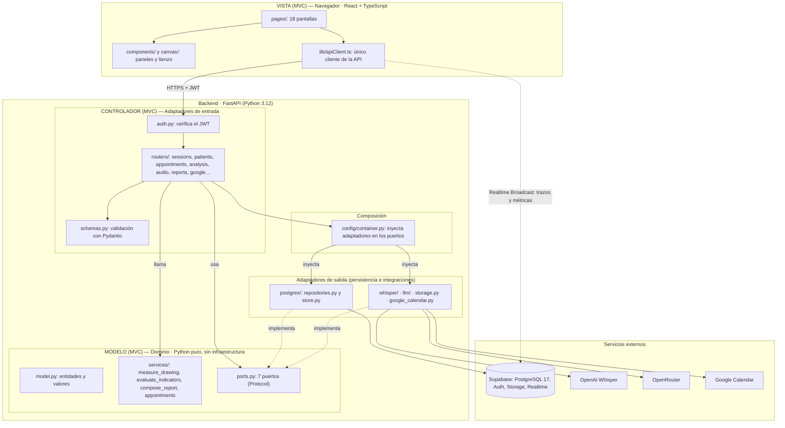
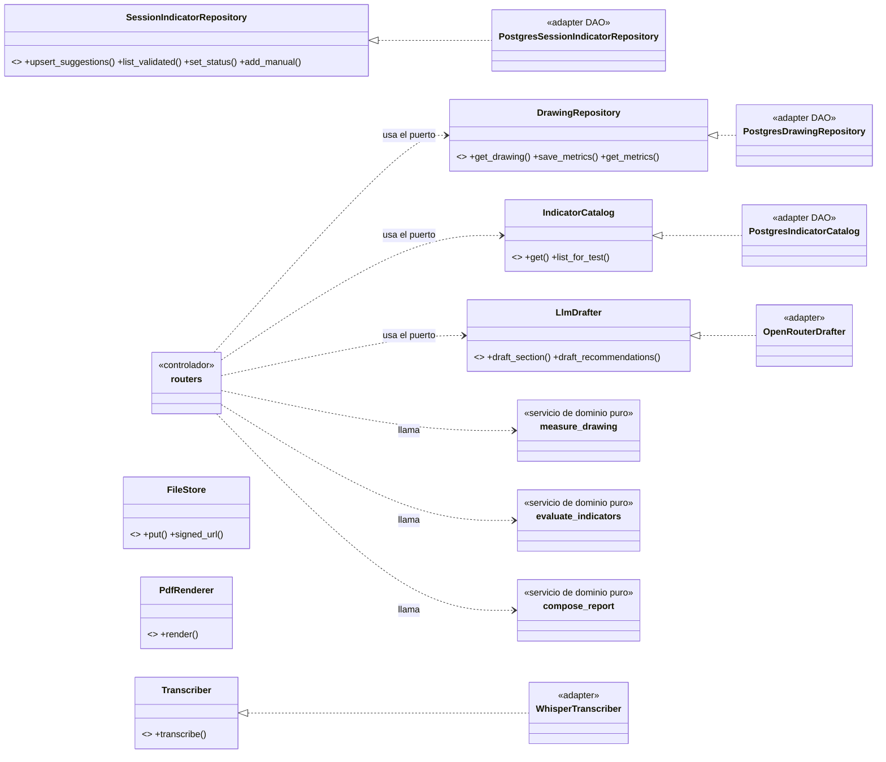
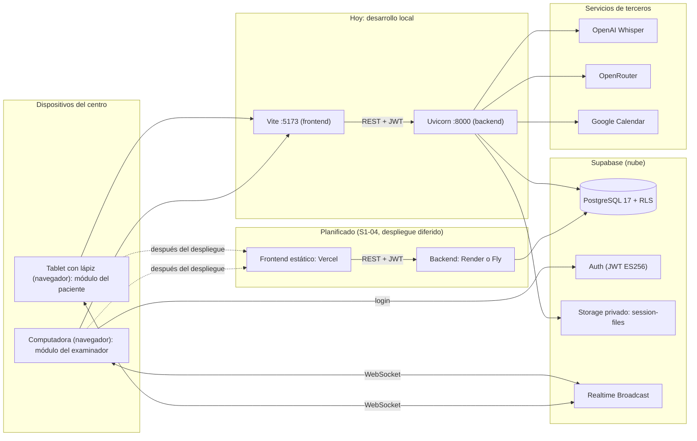
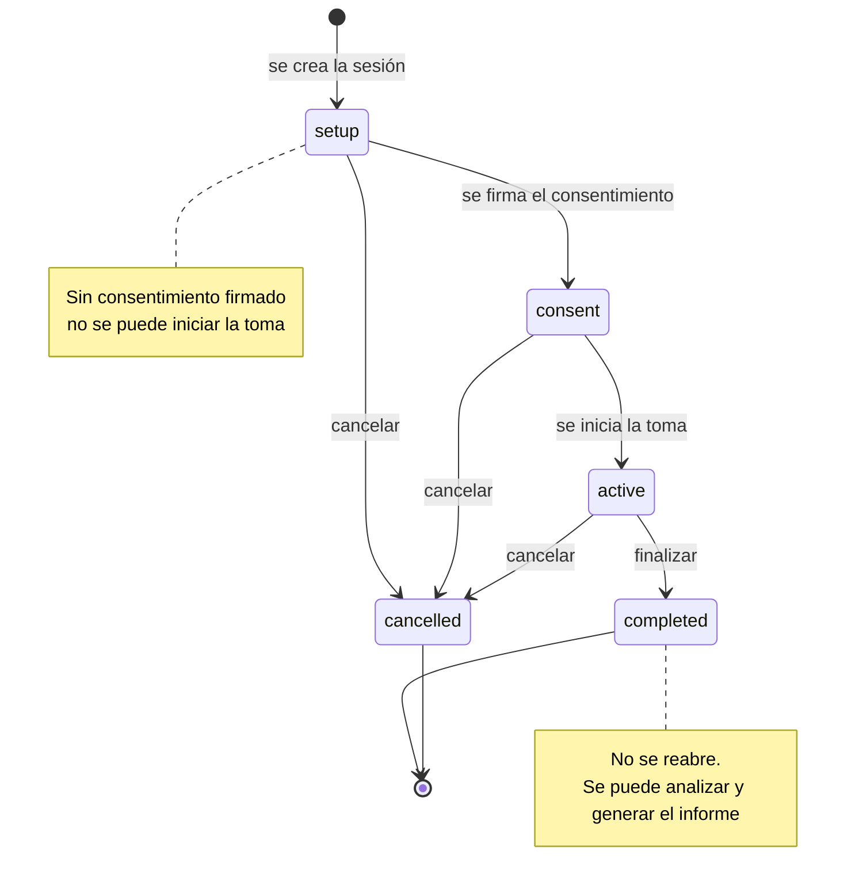
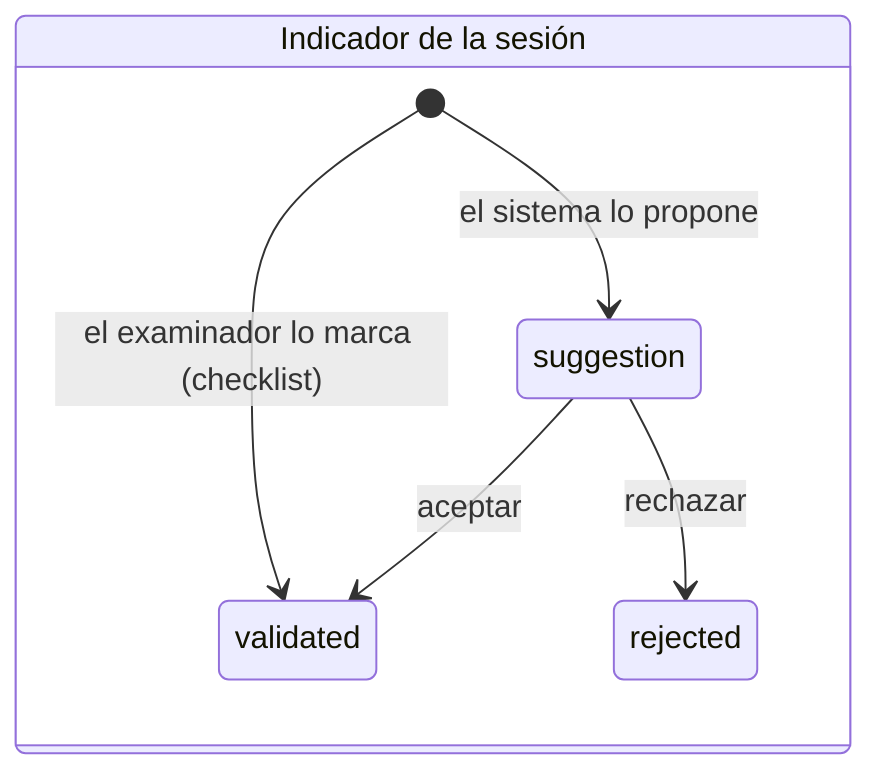
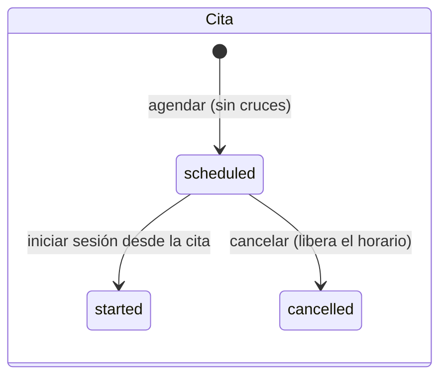

# Diagramas de arquitectura, despliegue, estados y modelo físico

> Complementan los diagramas del Capítulo 3 (§3.5 a §3.9) y el HTML `casos-de-uso.html`. Están en **Mermaid**: se pegan en <https://mermaid.live> para exportar PNG/SVG, o sirven de referencia para rehacerlos en la herramienta del equipo. Corte 28/10/2026.

| N.º | Diagrama | Para qué sirve |
|---|---|---|
| A | Arquitectura por capas (hexagonal) con MVC | **Exigido por la rúbrica** (estructura MVC) |
| B | Puertos y adaptadores (DAO) y principios SOLID | **Exigido por la rúbrica** (capa DAO y SOLID) |
| C | Despliegue | Dónde corre cada pieza (hoy y planificado) |
| D | Estados de la sesión | Ciclo de vida y transiciones permitidas |
| E | Estados del informe, del indicador y de la cita | Reglas de validación |
| F | Modelo físico de la base de datos (24 tablas) | Reemplaza la imagen del Avance 2 (tenía 22) |

---

## A. Arquitectura por capas (hexagonal) y correspondencia con MVC

| Capa MVC | En Psicograma | Carpeta |
|---|---|---|
| **Modelo** | Entidades y reglas de negocio, más los modelos de persistencia | `backend/src/psicograma/domain/`, `adapter/outbound/postgres/models.py` |
| **Vista** | Interfaz del examinador y del paciente | `frontend/src/pages`, `components`, `canvas` |
| **Controlador** | Routers que reciben la petición, validan y delegan | `backend/src/psicograma/adapter/inbound/http/` |

**Regla que sostiene el diagrama:** las flechas de dependencia apuntan **hacia el dominio**. El dominio no importa FastAPI, SQLAlchemy ni `httpx`; lo verifica `backend/scripts/check-hexagon.sh`.

---

## B. Puertos y adaptadores (capa DAO) y principios SOLID

| Principio | Cómo se ve en el diagrama |
|---|---|
| **S** — responsabilidad única | Un servicio de dominio por tarea (medir, evaluar, componer); son funciones puras, sin red ni base de datos |
| **O** — abierto/cerrado | Un adaptador nuevo (otro motor de base de datos, otro transcriptor) se agrega sin tocar el dominio |
| **L** — Liskov | Cualquier clase que cumpla el `Protocol` sustituye a otra; en las pruebas se reemplaza Whisper por un falso |
| **I** — segregación de interfaces | Siete puertos pequeños, no una interfaz única |
| **D** — inversión de dependencias | Los controladores dependen de los **puertos**, nunca de los adaptadores; `container.py` es el único lugar que los conecta |

---

## C. Despliegue

> El backend usa el **puerto 6543** (*transaction pooler*) en ejecución y el **5432** (conexión directa) solo para migraciones. La tablet debe cargar la app por la IP de red del equipo, y esa IP debe estar en `CORS_ORIGINS`.

---

## D. Estados de la sesión

*Transiciones tomadas de `TRANSICIONES` en `adapter/outbound/postgres/store.py`; cualquier otra devuelve 409.*

---

## E. Estados del informe, del indicador y de la cita

```mermaid
stateDiagram-v2
  direction LR
  state "Informe" as INF {
    [*] --> draft
    draft --> validated: validar (el editor exige las secciones completas; el servidor exige revisar la sugerencia de la sección 9)
    validated --> [*]
  }
```

| Regla | Dónde se garantiza |
|---|---|
| Un indicador `validated` exige responsable y fecha | `CHECK` en `session_indicators` |
| Un informe `validated` exige responsable y fecha | `CHECK` en `reports` |
| No se valida con la sugerencia de la sección 9 sin revisar | `ReportStore.validate` (409) |
| Re-analizar no pisa lo ya validado | `upsert_suggestions` |
| Dos citas activas no se cruzan | Restricción de exclusión en `appointments` |

---

## F. Modelo físico de la base de datos (24 tablas)

Generado a partir de `sdd/database/schema.sql`. **PK** = clave primaria, **FK** = clave foránea, **UK** = única. Reemplaza la imagen del Avance 2 (tenía 22 tablas; se agregaron `appointments` y `google_connections`). Las claves primarias compuestas aparecen con **PK** en cada columna que las forma. Para el Word, exportar a SVG/PNG desde mermaid.live (el diagrama es grande: conviene en una página apaisada).

```mermaid
erDiagram
  tests {
    UUID id PK
    TEXT code UK
    TEXT name
    BOOLEAN is_available
    TIMESTAMPTZ created_at
  }
  indicator_categories {
    UUID id PK
    UUID test_id FK
    TEXT code
    TEXT name
  }
  manual_sections {
    UUID id PK
    UUID category_id FK
    TEXT code
    TEXT name
    TEXT code_prefix
  }
  indicator_catalog {
    TEXT code PK
    UUID section_id FK
    TEXT title
    TEXT interpretation
    TEXT detection_type
    BOOLEAN is_active
  }
  quick_mark_catalog {
    TEXT code PK
    TEXT label
    SMALLINT display_order
  }
  attitude_catalog {
    TEXT code PK
    TEXT label
    SMALLINT display_order
  }
  profiles {
    UUID id PK,FK
    TEXT full_name
    TEXT license_number
    TEXT specialty
    TIMESTAMPTZ created_at
  }
  patients {
    UUID id PK
    TEXT full_name
    TEXT document_number
    DATE birth_date
    TEXT sex
    TIMESTAMPTZ registered_at
    UUID created_by FK
    BOOLEAN is_active
    TIMESTAMPTZ anonymized_at
  }
  sessions {
    UUID id PK
    UUID patient_id FK
    UUID test_id FK
    TEXT status
    TEXT reason
    UUID created_by FK
    TIMESTAMPTZ started_at
    TIMESTAMPTZ completed_at
    TIMESTAMPTZ created_at
  }
  consent_records {
    UUID id PK
    UUID session_id FK,UK
    BOOLEAN audio_authorized
    BOOLEAN digital_authorized
    BOOLEAN confidential_ack
    TEXT signature_url
    TIMESTAMPTZ signed_at
  }
  drawings {
    UUID id PK
    UUID session_id FK,UK
    TEXT final_image_url
    TEXT orientation
    INTEGER canvas_width
    INTEGER canvas_height
    TIMESTAMPTZ created_at
  }
  strokes {
    UUID id PK
    UUID drawing_id FK
    INTEGER stroke_index
    TEXT tool
    INTEGER started_at_ms
    INTEGER ended_at_ms
    INTEGER point_count
    REAL avg_pressure
    REAL bbox_x
    REAL bbox_y
    REAL bbox_width
    REAL bbox_height
    JSONB points
  }
  stroke_metrics {
    UUID id PK
    UUID session_id FK,UK
    INTEGER total_time_ms
    INTEGER latency_ms
    INTEGER stroke_count
    REAL pressure_avg
    INTEGER pause_count
    INTEGER erase_count
    REAL area_pct
    TEXT sequence_start
    TIMESTAMPTZ computed_at
  }
  audio_recordings {
    UUID id PK
    UUID session_id FK
    TEXT storage_path
    INTEGER duration_seconds
    INTEGER started_at_ms
    TIMESTAMPTZ transcribed_at
    TIMESTAMPTZ created_at
  }
  transcript_segments {
    UUID id PK
    UUID recording_id FK
    INTEGER segment_index
    INTEGER start_ms
    INTEGER end_ms
    TEXT text
    TEXT segment_type
  }
  session_observations {
    UUID session_id PK,FK
    TEXT additional_notes
    TIMESTAMPTZ created_at
    TIMESTAMPTZ updated_at
  }
  session_quick_marks {
    UUID id PK
    UUID session_id FK
    TEXT mark_code FK
    INTEGER marked_at_ms
    TIMESTAMPTZ created_at
  }
  session_attitudes {
    UUID session_id PK,FK
    TEXT attitude_code PK,FK
  }
  verbalizations {
    UUID id PK
    UUID session_id FK
    INTEGER offset_ms
    TEXT text
    TEXT source
    TIMESTAMPTZ created_at
  }
  session_indicators {
    UUID session_id PK,FK
    TEXT indicator_code PK,FK
    TEXT status
    TEXT source
    TEXT confidence
    TEXT evidence
    UUID validated_by FK
    TIMESTAMPTZ validated_at
    TIMESTAMPTZ created_at
  }
  reports {
    UUID id PK
    UUID session_id FK,UK
    TEXT status
    TIMESTAMPTZ validated_at
    UUID validated_by FK
    TEXT pdf_url
    TIMESTAMPTZ created_at
    TIMESTAMPTZ updated_at
  }
  report_sections {
    UUID id PK
    UUID report_id FK
    SMALLINT section_number
    TEXT title
    TEXT content
    BOOLEAN is_ai_generated
    BOOLEAN edited_by_examiner
    TIMESTAMPTZ updated_at
  }
  appointments {
    UUID id PK
    UUID patient_id FK
    UUID test_id FK
    UUID created_by FK
    TIMESTAMPTZ starts_at
    TIMESTAMPTZ ends_at
    TEXT status
    TEXT notes
    UUID session_id FK
    TEXT google_event_id
    TIMESTAMPTZ created_at
  }
  google_connections {
    UUID user_id PK,FK
    TEXT refresh_token
    TIMESTAMPTZ connected_at
  }
  tests ||--o{ indicator_categories : "test_id"
  indicator_categories ||--o{ manual_sections : "category_id"
  manual_sections ||--o{ indicator_catalog : "section_id"
  profiles ||--o{ patients : "created_by"
  patients ||--o{ sessions : "patient_id"
  tests ||--o{ sessions : "test_id"
  profiles ||--o{ sessions : "created_by"
  sessions ||--o{ consent_records : "session_id"
  sessions ||--o{ drawings : "session_id"
  drawings ||--o{ strokes : "drawing_id"
  sessions ||--o{ stroke_metrics : "session_id"
  sessions ||--o{ audio_recordings : "session_id"
  audio_recordings ||--o{ transcript_segments : "recording_id"
  sessions ||--o{ session_observations : "session_id"
  sessions ||--o{ session_quick_marks : "session_id"
  quick_mark_catalog ||--o{ session_quick_marks : "mark_code"
  sessions ||--o{ session_attitudes : "session_id"
  attitude_catalog ||--o{ session_attitudes : "attitude_code"
  sessions ||--o{ verbalizations : "session_id"
  sessions ||--o{ session_indicators : "session_id"
  indicator_catalog ||--o{ session_indicators : "indicator_code"
  profiles ||--o{ session_indicators : "validated_by"
  sessions ||--o{ reports : "session_id"
  profiles ||--o{ reports : "validated_by"
  reports ||--o{ report_sections : "report_id"
  patients ||--o{ appointments : "patient_id"
  tests ||--o{ appointments : "test_id"
  profiles ||--o{ appointments : "created_by"
  sessions ||--o{ appointments : "session_id"
  profiles ||--o{ google_connections : "user_id"
```

